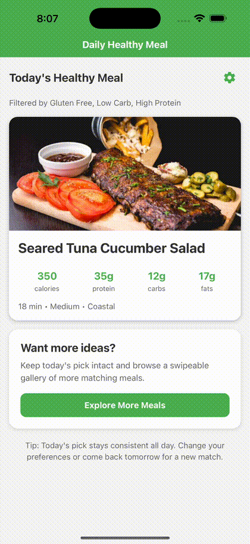
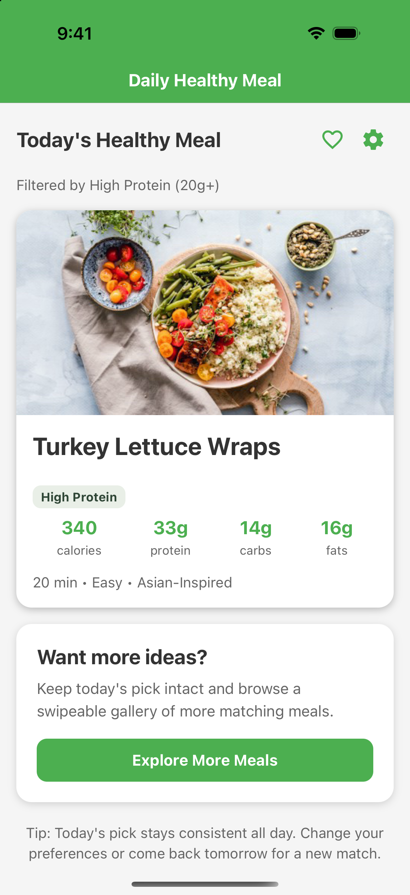
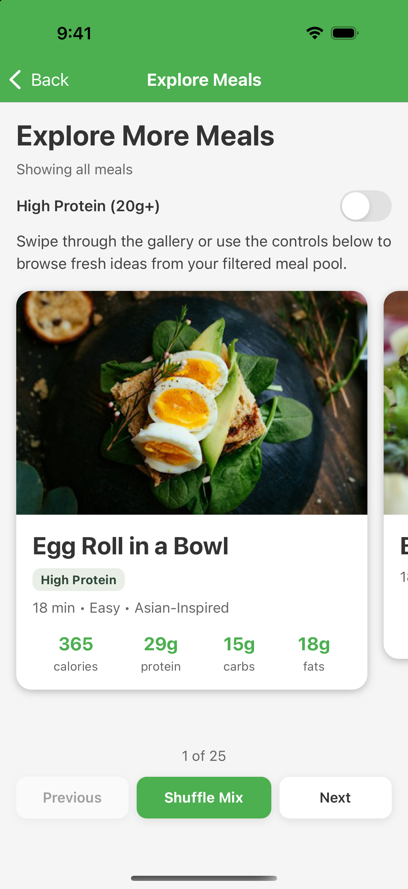
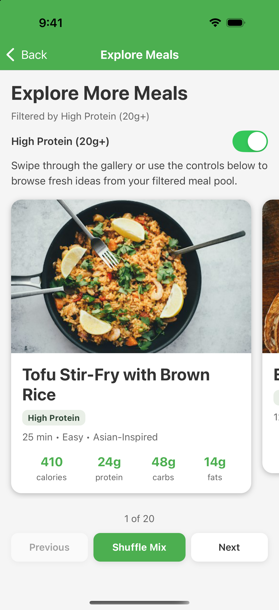
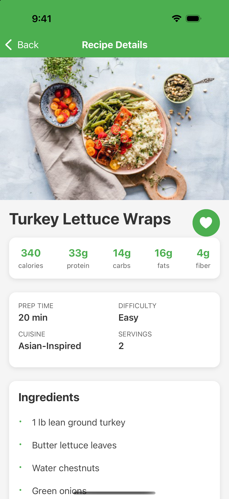
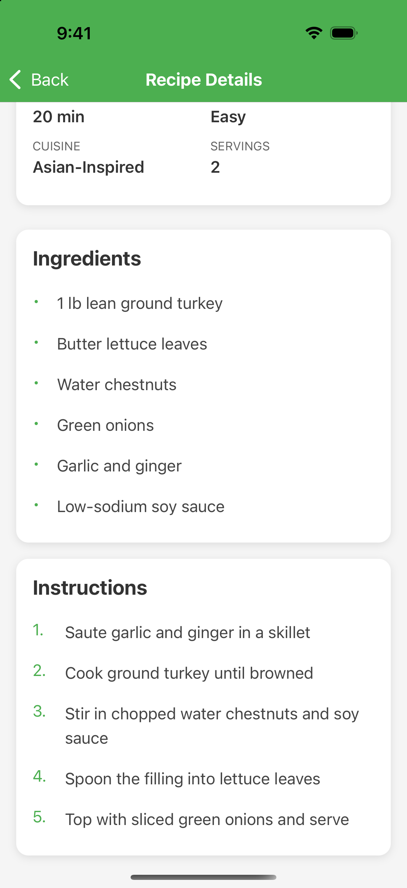
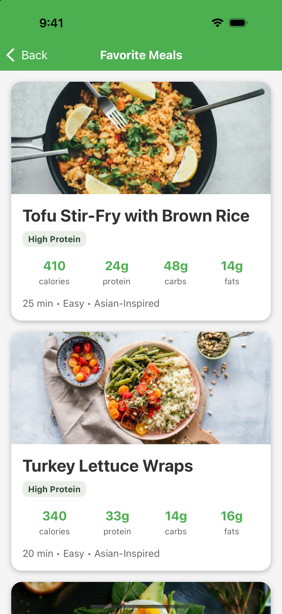
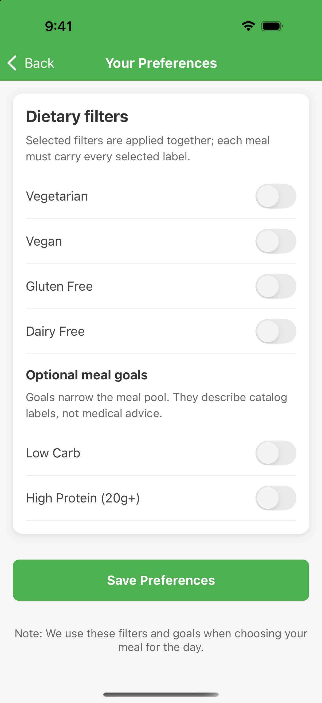
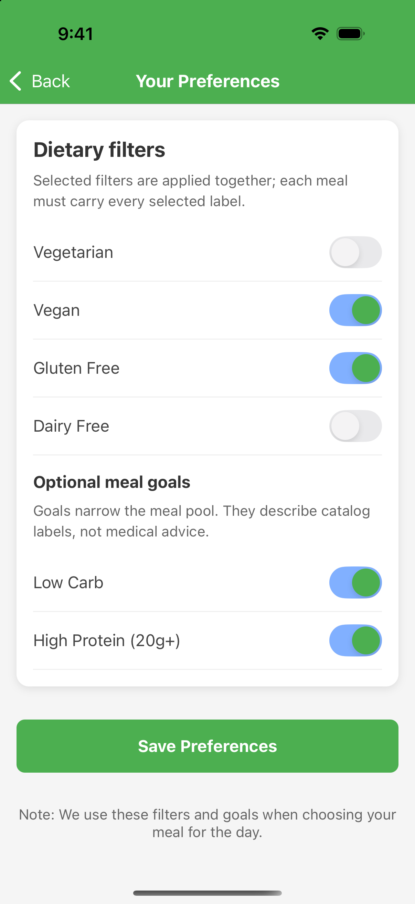
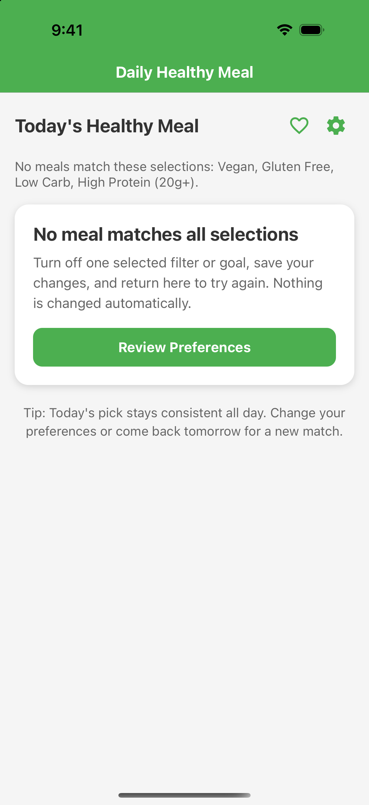

# Healthy Meal

[](https://github.com/amu3dev/healthy_meal_rn/actions/workflows/ci.yml)


A React Native app that picks one healthy meal for you each day, filtered by your dietary needs. Browse more ideas in a swipeable gallery, open full recipes, and save the ones you like. Your data stays on the device: no account and no backend.

<p align="center">
  
</p>

## Features

- **A daily pick that stays put.** One meal per day, chosen from the meals that match your filters. It doesn't reshuffle when you refresh; it changes when the day or your filters change.
- **Dietary filters and meal goals.** Vegetarian, vegan, gluten-free and dairy-free filters, plus low-carb and high-protein (20g+) goals. Selections combine, so a meal must match all of them.
- **Explore gallery.** Swipe through every matching meal in a shuffled order, with Previous, Next and Shuffle Mix controls. A High Protein switch narrows the gallery for the current visit without changing your saved preferences.
- **Recipe details.** Nutrition (calories, protein, carbs, fats, fiber), prep time, difficulty, cuisine, servings, ingredients and step-by-step instructions.
- **Favorites.** Tap the heart on any recipe and find it later in your Favorites list, newest first.
- **Handles the unhappy paths.** Clear messages when no meal matches your filters, retry buttons when saved data can't be read, and fallback cards when a photo fails to load.
- **Accessible by default.** Screen-reader labels, hints and states on buttons, switches and loading screens.

## Screenshots

<table>
  <tr>
    <td align="center"><strong>Daily pick</strong><br /></td>
    <td align="center"><strong>Explore</strong><br /></td>
    <td align="center"><strong>Explore, high protein</strong><br /></td>
  </tr>
  <tr>
    <td align="center"><strong>Recipe details</strong><br /></td>
    <td align="center"><strong>Ingredients and steps</strong><br /></td>
    <td align="center"><strong>Favorites</strong><br /></td>
  </tr>
  <tr>
    <td align="center"><strong>Preferences</strong><br /></td>
    <td align="center"><strong>Preferences set</strong><br /></td>
    <td align="center"><strong>No match</strong><br /></td>
  </tr>
</table>

## How it works

**Daily pick.** The app filters the catalog by your saved preferences, then hashes today's local date together with your active filters to choose one of the matching meals. The same day and filters always give the same meal, and changing either gives a new one. See `getDailyMeal` in [`lib/mealUtils.js`](lib/mealUtils.js).

**Filtering.** Each meal carries dietary tags. Selected filters and goals are combined with AND. High protein isn't a hand-set tag: it's worked out from the meal's protein value (20g or more), so the label can't drift from the nutrition data.

**Storage.** Preferences and favorites are saved on the device with AsyncStorage and never sent anywhere. Meal photos load from Unsplash and are cached on the device.

## Getting started

**Requirements:** Node.js 22 (the version CI uses) and either the [Expo Go](https://expo.dev/go) app on a phone, or an iOS Simulator or Android emulator.

```bash
npm install
npm start
```

Then scan the QR code with Expo Go, or press `i` for the iOS Simulator or `a` for an Android emulator. Shortcuts: `npm run ios` and `npm run android`.

## Testing and quality

```bash
npm run check
```

This runs the same checks as CI:

- **ESLint** with `eslint-config-expo`, with zero warnings allowed (`npm run lint`).
- **Expo dependency check:** installed packages match Expo SDK 52 (`npm run check:expo`).
- **Jest + React Native Testing Library:** 14 suites and 78 tests (`npm test`) covering filtering and daily-pick logic, catalog data integrity, the preferences and favorites hooks, shared components, every screen, and one integration test from storage through to the rendered daily meal.

GitHub Actions runs `npm run check` on every push to `master` and on every pull request ([workflow](.github/workflows/ci.yml)).

## Project structure

```text
App.js            Navigation stack (Home, Explore, Recipe Details, Preferences, Favorites)
screens/          One file per screen
components/       MealCard (shared meal summary) and MealImage (cached image with fallback)
hooks/            usePreferences and useFavorites (AsyncStorage-backed state)
lib/              Meal selection and filtering, preferences, favorites, theme tokens, JSDoc types
data/meals.js     The 25-meal catalog
__tests__/        Jest test suites
docs/             Screenshots and the product case study
```

## Tech stack

Expo SDK 52 · React Native 0.76 (New Architecture) · React 18 · React Navigation 7 (native stack) · AsyncStorage · expo-image · Jest · React Native Testing Library · ESLint

## Case study

This project is also a worked product case study: a technical audit, product thesis, prioritized roadmap and implementation briefs. See [`docs/consulting-case-study`](docs/consulting-case-study/README.md).

## Roadmap

- Move from JSDoc types to TypeScript.
- Load meals from a backend or CMS instead of a bundled file.
